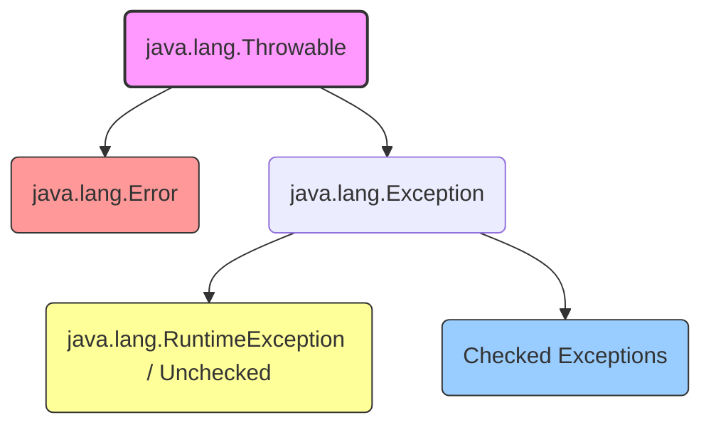

# 🛠️ Java Exception Handling: Master Guide

A comprehensive, production-ready reference guide to mastering **Exception Handling** in Java. This repository covers everything from structural architecture to production best practices and code implementations.

---

## 📌 Table of Contents
* [1. Hierarchy & Architecture](#1-hierarchy--architecture)
* [2. Core Categories](#2-core-categories)
* [3. Mechanics & Key Keywords](#3-mechanics--key-keywords)
* [4. Advanced Frameworks & Modern Java](#4-advanced-frameworks---modern-java)
* [5. Production Best Practices](#5-production-best-practices)
* [6. Getting Started](#6-getting-started)

---

## 1. Hierarchy & Architecture

Understanding the exception blueprint is key to tracking code anomalies cleanly. Java's structural system flows from the base `Throwable` engine:



* **`Throwable`:** The root absolute class for all objects that can be thrown via the JVM.
* **`Error`:** Critical external failures that a standard application should not try to catch (e.g., `OutOfMemoryError`, `StackOverflowError`).
* **`Exception`:** Application-level conditions that a reasonable program will want to anticipate and trap.

---

## 2. Core Categories

| Exception Category | Description | Enforcement Phase | Common Examples |
| :--- | :--- | :--- | :--- |
| **Checked Exceptions** | Expected conditions that a method must explicitly declare or handle. | **Compile-Time** | `IOException`, `SQLException` |
| **Unchecked Exceptions** | Internal logic flaws or api API misuse that inherit from `RuntimeException`. | **Runtime** | `NullPointerException`, `IllegalArgumentException` |

---

## 3. Mechanics & Key Keywords

Java relies on five primary keywords to handle and route failure data:

### Try-Catch Blocks
Safely wraps code execution paths and provides isolation policies for explicit failures.
```java
try {
    int data = 50 / 0;
} catch (ArithmeticException e) {
    System.err.println("Cannot divide by zero: " + e.getMessage());
}
```

### Try-With-Resources
Automatically releases system handles implementing `AutoCloseable` to prevent underlying leak scenarios.
```java
try (BufferedReader br = new BufferedReader(new FileReader("config.txt"))) {
    System.out.println(br.readLine());
} catch (IOException e) {
    e.printStackTrace();
}
```

### Throw vs Throws
* **`throw`:** Explicitly triggers a brand new specific instance of an error object into runtime flow.
* **`throws`:** Defines a method signature warning telling upstream executors what exceptions to expect.

---

## 4. Advanced Frameworks & Modern Java

### Custom Exception Engineering
Build explicit domain exceptions to wrap system exceptions with functional context:

```java
public class InvalidBankAccountException extends Exception {
    public InvalidBankAccountException(String message) {
        super(message);
    }
}
```

### Enterprise Global Interceptors
For enterprise layers (e.g., Spring Boot), use interception contexts to handle application anomalies seamlessly:

```java
@RestControllerAdvice
public class GlobalExceptionHandler extends ResponseEntityExceptionHandler {

    @ExceptionHandler(InvalidBankAccountException.class)
    public ResponseEntity<Object> handleCustomException(InvalidBankAccountException ex) {
        Map<String, Object> body = new LinkedHashMap<>();
        body.put("timestamp", LocalDateTime.now());
        body.put("message", ex.getMessage());
        
        return new ResponseEntity<>(body, HttpStatus.BAD_REQUEST);
    }
}
```

---

## 5. Production Best Practices

* **Throw Early, Catch Late:** Verify incoming parameters up front to trigger failures fast, but wait to handle them until you can take recovery actions.
* **Never Swallow Exceptions:** Avoid leaving catch blocks empty (`catch (Exception e) {}`). Always log or properly wrap exceptions.
* **Preserve the Cause:** When wrapping exceptions, include the original cause so the root trace isn't lost: `throw new CustomException("Failed", originalException);`.
* **Avoid General `Exception` Catching:** Trap specific target classes instead of catching the generic `java.lang.Exception` superclass to avoid masking unexpected bugs.

---

## 6. Getting Started

### Prerequisites
* **Java SDK 17+**
* **Maven 3.6+**

### Building and Running
1. Clone this repository:
   ```bash
   git clone https://github.com
   ```
2. Navigate to the project root and compile the examples:
   ```bash
   mvn clean package
   ```
3. Run the demonstration suite:
   ```bash
   java -jar target/exception-demo-1.0.jar
   ```
